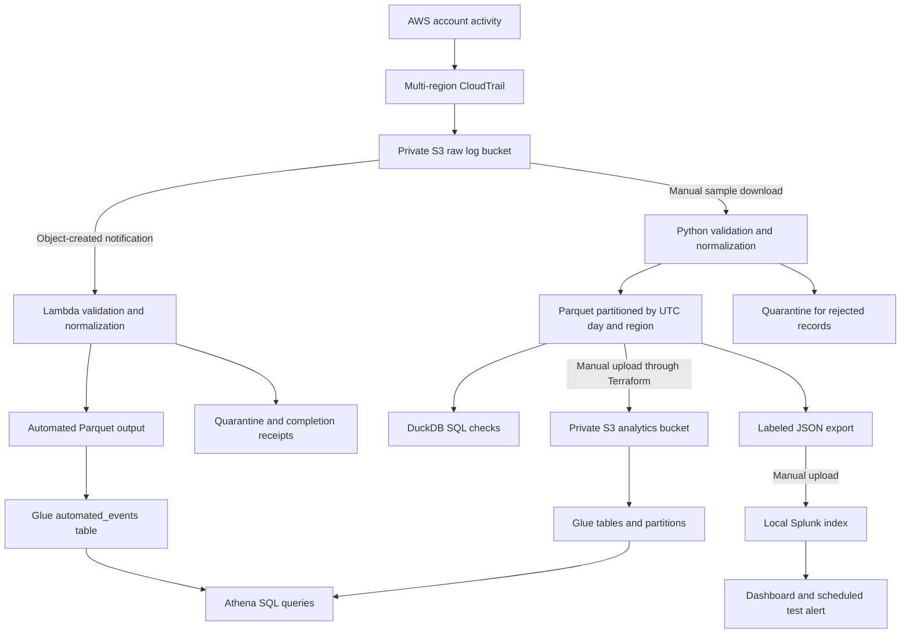

# Cloud Detection Pipeline

A cloud security data pipeline that collects AWS account activity with CloudTrail, transforms logs into partitioned Parquet datasets, and detects IAM policy attachments and successful console logins without MFA using SQL and Splunk.

This portfolio project combines real AWS audit logs with labeled synthetic detection tests. Terraform defines the AWS infrastructure, Python validates and transforms the events, and Athena and Splunk query the same normalized data.

New CloudTrail files are processed automatically by an [S3-triggered Lambda](docs/AUTOMATION.md) into a separate Athena table. The manual sample path remains available for reproducible checks and local Splunk imports. Scheduled Splunk alerts were verified for a synthetic login and a real controlled IAM policy change, then disabled after evidence was saved.

## Tech Stack

| Component | Tool | Purpose |
| --- | --- | --- |
| Audit logging | AWS CloudTrail | Collect management activity across regions |
| Object storage | Amazon S3 | Store raw logs, Parquet datasets, and query results |
| Infrastructure | Terraform | Define storage, CloudTrail, Glue, and Athena resources |
| Processing | Python and PyArrow | Validate JSON events and write typed Parquet files |
| Automatic processing | AWS Lambda and S3 notifications | Transform newly delivered CloudTrail objects |
| Failure handling | Amazon SQS and CloudWatch Logs | Retain failed invocations and short-lived runtime logs |
| Local queries | DuckDB | Check SQL behavior against local datasets |
| Catalog and queries | AWS Glue and Athena | Describe partitions and query the analytics data |
| Security monitoring | Splunk Enterprise | Search events, display findings, and test scheduled alerts |
| Automated checks | GitHub Actions | Run Python tests and Terraform validation and mock tests |

## Architecture



Raw CloudTrail files remain separate from normalized analytics data. Python applies a consistent schema before writing Parquet. Real and synthetic samples use separate Athena tables and explicit labels in Splunk, so a test finding can be distinguished from observed account activity.

Athena supports SQL analysis over the stored datasets. Splunk provides the dashboard and alert workflow. Comparing their counts and findings checks that both paths interpret the sample consistently.

## Data Model and Processing

Each normalized row represents a CloudTrail event. Fields include the event ID, time, account, principal, source IP, region, service, action, outcome, error code, and MFA value. The current model is a normalized event table partitioned by UTC day and region.

The processor:

- Reads plain JSON and compressed CloudTrail files with input size limits.
- Validates required fields and keeps rejected records in quarantine.
- Removes identical duplicates within a dataset using account ID and event ID. Conflicting copies are quarantined.
- Writes Parquet and a manifest with file hashes and a completion marker.
- Checks completed output before reusing an identical run. Changed input requires a new output location.

Timestamps use UTC. Parquet stores millisecond timestamps, while a separate text field preserves supported submillisecond precision. Missing MFA information remains unknown and does not count as evidence that MFA was absent.

See the [data model and processing guide](docs/DATA_MODEL.md) for the schema, limits, and replay behavior.

## Detection

The implemented rule identifies a `ConsoleLogin` event from `signin.amazonaws.com` when the login succeeded and MFA is explicitly recorded as false.

| Test event | Outcome | MFA | Expected finding |
| --- | --- | --- | --- |
| Successful login without MFA | Success | False | Yes |
| Successful login with MFA | Success | True | No |
| Failed login | Failure | False | No |

The rule is implemented in [Python](cloud_detection/pipeline.py), [Athena SQL](sql/detections/console_login_without_mfa.sql), and [Splunk SPL](splunk/searches/synthetic_no_mfa_login.spl). The synthetic sample tests the rule without disabling MFA on real account access.

The Splunk test alert used an All time search and a temporary one-minute schedule. It added findings to Triggered Alerts without outbound notifications. The schedule fired and was disabled after verification. Its [settings and result](splunk/alerts/synthetic_no_mfa_test.md) are documented separately.

A second rule flags successful `AttachUserPolicy` events from `iam.amazonaws.com`. It was checked against a real, reversible IAM change: a dedicated user received only permission to read the project bucket's location, with no password or access keys. The event passed through CloudTrail storage, Python, Parquet, Athena, and Splunk, where a scheduled alert fired. The permission, policy, and user were removed. This behavior maps to [MITRE ATT&CK T1098.003](https://attack.mitre.org/techniques/T1098/003/), but the exercise demonstrates a benign permission change rather than an actual compromise.

## Results and Dashboard

The initial sample contained 26 records from three real CloudTrail files, including a harmless `GetBucketVersioning` verification action. Eight selected IAM scenario records expanded the dataset to 34 real events, all accepted without rejects.

| Check | Real sample | Synthetic sample |
| --- | --- | --- |
| Events read by Athena | 34 | 3 |
| Events shown in Splunk | 34 | 3 |
| Successful logins without MFA | 0 | 1 |
| Managed IAM policy attachments | 1 | 0 |


The no-MFA finding is synthetic; the IAM finding comes from the controlled AWS scenario. Zero real no-MFA findings is not a security assessment of the account. The [investigation report](docs/INVESTIGATION_IAM_POLICY.md) separates the observed behavior from the test's limitations.

[Validation notes](docs/VALIDATION.md) and [aggregate evidence reports](docs/evidence/) record the checks. Raw account logs, credentials, Terraform state, and screenshots containing account details are excluded from the repository.

## Running the Local Example

Python 3.11 or newer is required. The synthetic example runs without AWS credentials.

```powershell
python -m venv .venv
.\.venv\Scripts\python.exe -m pip install ".[test]"
.\.venv\Scripts\python.exe -m cloud_detection --input examples/cloudtrail.json --output work/findings.json
.\.venv\Scripts\python.exe -m cloud_detection etl --input examples/cloudtrail.json --output work/demo-dataset
.\.venv\Scripts\python.exe -m unittest discover -s tests -v
```

The detection command returns one synthetic finding. The ETL command creates a Parquet dataset, quarantine output, and manifest. Use a fresh output path for changed input.

See [AWS deployment](docs/DEPLOYMENT.md), [Athena setup](docs/ATHENA.md), and [Splunk setup](docs/SPLUNK.md) for the remaining steps. AWS deployment creates billable resources.

## Testing

The local suite contains **52 Python tests** and **12 Terraform mock tests**. Coverage includes invalid events, UTC boundaries, missing MFA values, duplicate conflicts, bounded input handling, output integrity, replay behavior, SQL agreement, labeled Splunk exports, the narrow IAM scenario, and Lambda processing and packaging. Live checks verified native imports, an identical-event replay, automatic processing of a new log file, Athena read-back, and delivery of a controlled failure to SQS.

GitHub Actions runs the Python suite, synthetic example, ETL example, Terraform formatting, validation, and mock tests. Hosted [Python tests](https://github.com/echeekene/Cloud-detection-pipeline/actions/runs/40805508123) and [Terraform checks](https://github.com/echeekene/Cloud-detection-pipeline/actions/runs/40805508126) passed. Mock tests do not deploy resources or prove live AWS behavior; live checks are documented separately.

## Security and Cost Controls

- Raw and analytics buckets use encryption, versioning, public-access blocking, and HTTPS-only policies.
- CloudTrail records multi-region management activity and generates digest files. Digest-chain validation is still pending.
- Raw data has a 30-day lifecycle; analytics data and results have a seven-day lifecycle.
- The Athena workgroup enforces encrypted results and a 10 MiB scan limit per query.
- Real account access keeps MFA enabled. Detection tests use labeled synthetic events.
- Account-specific variables, state, generated datasets, and raw logs remain outside Git.

The build has a **$20 total spending ceiling**, aiming lower. Existing $5 monthly budget alerts provide warnings but do not stop charges. The current billing console showed an estimated **$0.00**, with the bill pending; this is not a finalized project total. AWS logging and storage remain active until teardown is tested and completed.

## Tradeoffs

- **Separate manual and automatic paths:** fixed samples make results reproducible, while Lambda processes newly delivered files into a different table. Splunk imports remain manual, and the cloud processing path does not schedule detections.
- **Complete dataset snapshots:** manifests and file hashes make reruns verifiable. This approach keeps a run in memory and does not solve deduplication across different snapshots.
- **Parquet for analysis:** typed, partitioned files support SQL checks in DuckDB and Athena. Catalog and upload steps add work compared with reading raw JSON directly.
- **Local Splunk:** the existing installation supports dashboard and alert testing without hosting another cloud server. Scheduled searches depend on the available license; the existing Enterprise trial is time limited.
- **Synthetic no-MFA tests:** deterministic examples test success, failure, and MFA handling without weakening real access. They do not demonstrate an actual attack or incident response.

See [design decisions](docs/DECISIONS.md) for further context.

## Known Limitations

- Automatic transformation is enabled, but there is no continuous Splunk forwarding or active security alert schedule.
- Lambda publishes stable output keys per source object and version. Different files can still contain repeated events, and publication is not atomic across multiple partitions. The function uses shared account concurrency because the account quota cannot support a separate reservation.
- The expanded real sample contains only 34 records. Detection coverage includes console logins without MFA and successful managed-policy attachments to IAM users. An attachment finding requires investigation; the rule does not determine whether the added permissions are excessive.
- The first Splunk imports had incorrect time-zone interpretation. Those records remain stored in the lab index; searches explicitly select the corrected UTC source type.
- Athena results and the dashboard reflect selected snapshots rather than all current account activity.
- The deployment identity has broader existing IAM permissions. Project-scoped analytics permissions do not make the whole account least privilege.
- Digest-chain validation, measured costs, and tested AWS teardown remain unfinished.

## Issues Encountered and Improvements

**Time-zone interpretation:** Splunk initially recognized the timestamp text but applied the computer time zone. An explicit GMT parser corrected the new import. Future ingestion checks should compare the parsed instant with the source value before indexing.

**Duplicate JSON extraction:** applying `spath` after JSON fields were already extracted produced duplicate values and broke event-key calculations. The searches now use the fields extracted by the source type.

**Cross-platform Terraform checks:** the first hosted workflow failed because the lock file lacked the Linux package hash. Both modules now record official Windows and Linux provider hashes, and the hosted checks pass.

## Repository Layout

```text
cloud_detection/    Normalization, detection, Parquet processing, and JSON export
examples/           Synthetic CloudTrail sample
tests/              Python and SQL behavior tests
infra/foundation/   CloudTrail and raw S3 storage
infra/analytics/    Analytics storage, sample uploads, Glue, and Athena
infra/scenario/     Temporary IAM test user, narrow policy, and attachment
infra/automation/   Lambda, failure queue, S3 trigger, and automated table
infra/access/       Analytics permission template
scripts/            Snapshot preparation and Athena verification helpers
sql/                Detection query and reference table definition
splunk/             Searches, dashboard XML, and test alert settings
docs/               Setup, data model, decisions, limitations, and evidence
.github/workflows/  Python and Terraform checks
```

## Planned Extensions

The controlled IAM scenario has been executed and reversed, and automatic log processing is verified. The [investigation report](docs/INVESTIGATION_IAM_POLICY.md) and [automation notes](docs/AUTOMATION.md) record the results and limitations. Remaining work includes a protected read-only findings API, digest validation, and tested cleanup of the main AWS infrastructure. AI summaries and a randomized simulator are optional stretch additions.

The [roadmap](docs/ROADMAP.md) separates these planned extensions from the implemented system.
