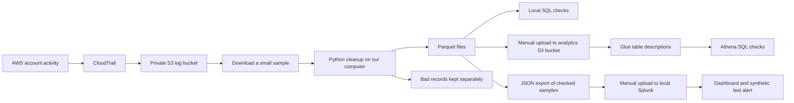
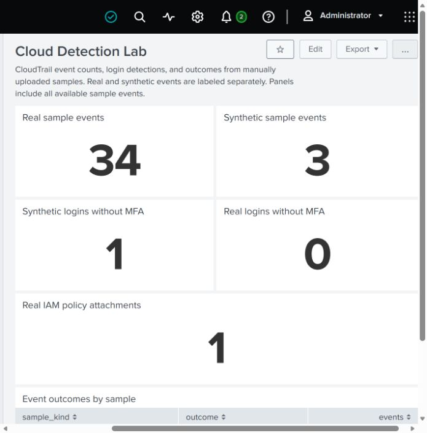

# Cloud Detection Pipeline

A cloud security pipeline that collects AWS security logs, cleans them with Python, and uses SQL and Splunk to look for suspicious activity.

We are building this a piece at a time. The goal is to understand the tools and finish a working pipeline we can explain. We can simplify parts of the original plan as we learn what is useful and what adds too much work or cost.

## What works so far

- CloudTrail collects management events from our AWS account and sends them to a private S3 bucket.
- Terraform creates the bucket, its security settings, and the trail.
- Python reads plain or compressed CloudTrail files and puts the events into a consistent format.
- The local processor removes repeated events, sets aside bad records, and writes Parquet files grouped by day and region.
- A basic rule finds successful console logins recorded without MFA. We tested it with made-up events so we can keep MFA enabled on our real account.
- The same detection works as a SQL query against the local Parquet files.
- The cleaned real and synthetic samples are in separate S3 folders and Glue tables. Athena reads them and finds the expected test event.
- Splunk displays the same sample counts and findings. A scheduled synthetic alert fired and was disabled after verification.

The processing step currently runs on our computer, and we manually upload the selected output with Terraform. Athena is working in AWS. Splunk now shows the same sample counts and detection results in a private local dashboard. Automatic cloud processing is still to be added.

## What we are practicing

- **Cloud security:** MFA, permissions, private storage, and checking that logging actually works.
- **Data engineering:** reading JSON, cleaning fields, handling duplicates, writing Parquet, and using SQL.
- **Software development:** organizing Python code, testing behavior, and using GitHub Actions.
- **Explaining our work:** showing what works, why we chose it, and what we would improve.

## Tech stack

| Tool | Why we are using it | Progress |
| --- | --- | --- |
| AWS CloudTrail | Collect account activity | Running |
| Amazon S3 | Store the original logs | Running |
| Terraform | Keep the AWS setup in code | Used for the first deployment |
| Python | Clean logs and run the local pipeline | Working |
| PyArrow / Parquet | Write files that are useful for SQL queries | Working locally |
| DuckDB | Try SQL on those files without paying for cloud queries | Working locally |
| Glue / Athena | Describe and query the files in AWS | Deployed; real and synthetic sample queries checked |
| Splunk | Try SIEM searches, alerts, and dashboards | Working locally; 26 real events, 3 synthetic events, and a checked dashboard |
| Amazon Bedrock | Try explaining findings with AI | Later in the plan |

## How the data moves

What we have built:



**Why start this way?** It lets us follow each step: look at the logs, test the Python code, upload a small result, and query it in AWS. We can understand that path before adding automatic processing.

The next priorities are one controlled AWS security scenario, automatic log processing, and a protected findings API. AI and a randomized simulator are optional later additions. The [roadmap](docs/ROADMAP.md) tracks them.

## Running it locally

Use Python 3.11 or newer. These commands are for Windows and do not need AWS credentials:

```powershell
python -m venv .venv
.\.venv\Scripts\python.exe -m pip install ".[test]"
.\.venv\Scripts\python.exe -m cloud_detection --input examples/cloudtrail.json --output work/findings.json
.\.venv\Scripts\python.exe -m cloud_detection etl --input examples/cloudtrail.json --output work/demo-dataset
.\.venv\Scripts\python.exe -m unittest discover -s tests -v
```

The example contains three made-up events. The login rule should find one successful login without MFA. The ETL command writes the cleaned data as Parquet and creates a small report about the run.

For the AWS setup and cleanup steps, see [Deployment](docs/DEPLOYMENT.md). For the fields, output folders, and how rerunning works, see [Data model](docs/DATA_MODEL.md).

## Repository layout

```text
cloud_detection/    Python cleanup, detection, and Parquet processing
examples/           Made-up logs for trying the code safely
tests/              Tests for the Python code and SQL behavior
infra/foundation/   Terraform for S3 and CloudTrail
infra/analytics/    Analytics bucket, sample uploads, Glue tables, and Athena settings
infra/access/       Project permissions used for the analytics step
scripts/            Small helpers to prepare samples and check Athena results
sql/                Detection query and a table template for Athena
splunk/             Searches and the first dashboard layout
docs/               Setup steps, data notes, decisions, and results
.github/workflows/  Checks to run when the project is pushed
```

## Testing and results so far

We checked three real files delivered by CloudTrail. They contained **26 records**, and all 26 were converted to Parquet without rejected records. A SQL query could read all of them back.

Athena read back **26 real rows** and **3 synthetic rows**. The no-MFA query found **one event in the made-up sample** and **none in the real sample**, matching our local results. That is a working SQL detection check; a scheduled synthetic Splunk alert also fired and was disabled after verification.

All **38 Python tests** pass locally. They check things like missing fields, repeated events, bad files, date boundaries, rerunning the same input, whether the Python and SQL rules agree, and preparing JSON files for Splunk. The four foundation and three analytics Terraform mock tests also passed. Both the [Python tests](https://github.com/echeekene/Cloud-detection-pipeline/actions/runs/40805347850) and [Terraform checks](https://github.com/echeekene/Cloud-detection-pipeline/actions/runs/40805347584) passed on GitHub Actions.

Splunk's private dashboard shows the same counts and findings as Athena:



More details are in [Testing and results](docs/VALIDATION.md). The dashboard image contains aggregate results. Screenshots with account details and original account logs are kept outside the repository.

## Choices and tradeoffs

- **Manual processing first.** Downloading and processing a small sample is easier to follow. Automatic processing can come after the basic path works.
- **A whole dataset per run.** This makes reruns easier to check, but it does not solve duplicates across separate datasets.
- **A separate file for bad records.** One bad event should not make us throw away the good ones. We keep rejected records so we can inspect them later.
- **Keep real account MFA enabled.** We use made-up events to test a login without MFA instead of weakening our normal access.
- **Keep costs small.** Our maximum is **$20 for the whole build**, and we want to spend less. The account already has a $5 monthly budget with alerts. That alert is a warning, not an automatic spending limit.

The [decision notes](docs/DECISIONS.md) explain these choices in more detail.

## Limitations and unfinished work

This is a small learning project. The Python processing runs locally and keeps a run's data in memory. It is not ready for a large or continuously running workload.

The local synthetic Splunk alert fired and is now disabled. We still need to measure costs and test the AWS cleanup procedure. The [Splunk notes](docs/SPLUNK.md) explain the small manual example, and the [Athena notes](docs/ATHENA.md) explain the working AWS query setup. VPC Flow Logs, simulations, and AI are later parts of the plan. Some of these may be simplified as we work through them.

## Learning notes

We are keeping [learning notes](docs/LEARNING.md) with questions to work through and observations from the build. Personal reflections and a final “what we would do differently” section will be added as we review the project together.
