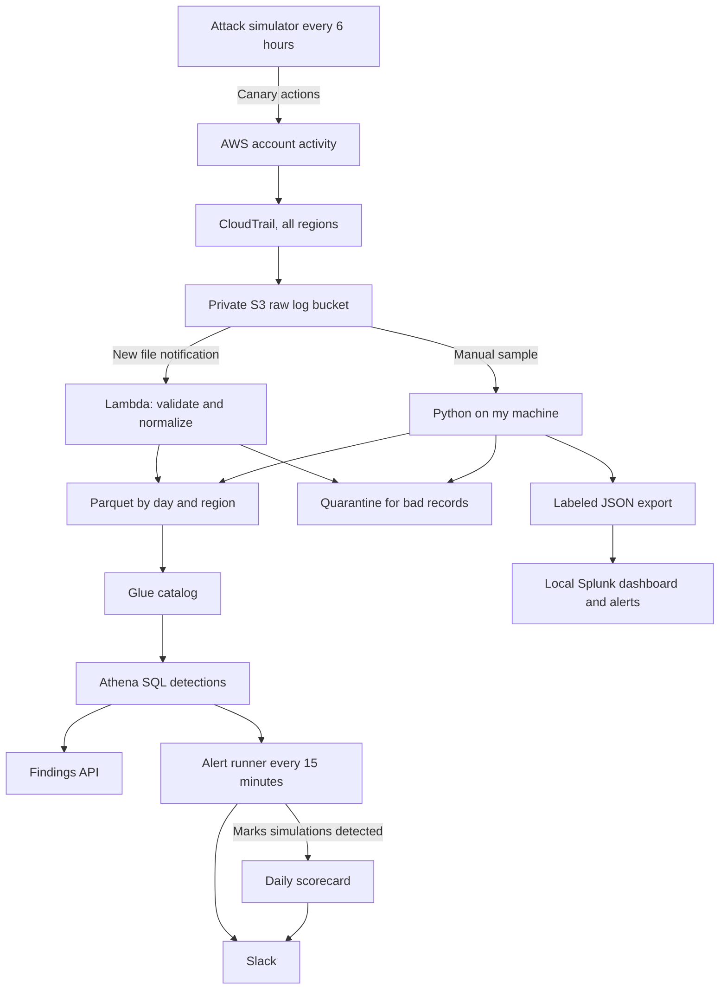
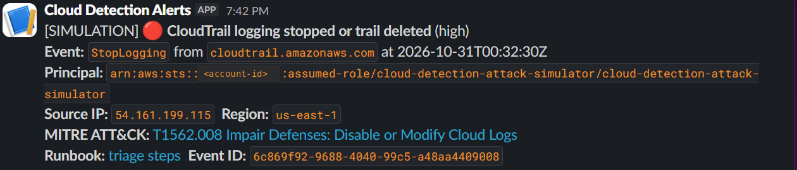
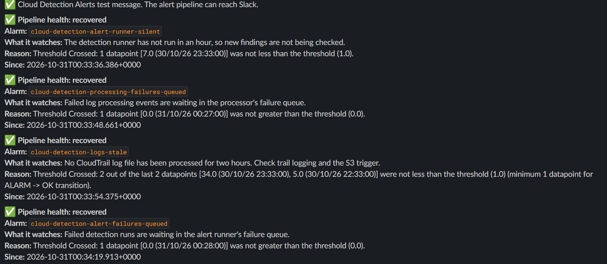

# Cloud Detection Pipeline

A cloud security project that collects AWS account activity with CloudTrail, cleans it into queryable Parquet tables, and detects risky events with SQL in Athena. Detections run every 15 minutes and alert in Slack, an attack simulator checks that they still fire, and changes reach AWS through a reviewed CI/CD pipeline. Everything in AWS is defined in Terraform and checked by automated tests.

I built it to practice the work a cloud security or SOC analyst does: getting logs into a usable shape, writing detections, proving they fire, and investigating what they find.

## What this is and what it is not

**What this is**

- A working pipeline in a real AWS account: CloudTrail logs land in S3, a Lambda function cleans each new file automatically, and Athena queries the result.
- Six detections mapped to MITRE ATT&CK, each with SQL and Python logic tested to agree and a triage runbook. The first two are also written in Splunk SPL.
- Live alerting: every 15 minutes the detections run in Athena and each new finding reaches Slack exactly once.
- Continuous validation: an attack simulator performs a harmless, reversible action every six hours, and a daily scorecard reports what was caught and how fast.
- Health monitoring: eight CloudWatch alarms watch the pipeline itself.
- A real, controlled test of the IAM detection: a harmless permission change was made, detected, investigated in a [written report](docs/INVESTIGATION_IAM_POLICY.md), and reversed.
- CI/CD through GitHub OIDC: pull requests get a read only plan, and deploys need my approval and apply only the reviewed changes. No AWS keys are stored in GitHub.
- Infrastructure as code with security defaults: encrypted and versioned buckets, blocked public access, HTTPS only, short data retention, remote state with locking, and a per query scan limit.
- 90 Python tests and 31 Terraform mock tests, run on every push by GitHub Actions.

**What this is not**

- **Not a production SIEM.** It watches one lab account with low event volume. Alerts go to one Slack channel with no on call paging or backup channel, and Splunk is a local trial with manual imports.
- **Not a security assessment of my account.** Zero real findings only means these two rules did not match in the sampled data.
- **Not proof against real attackers.** Findings come from synthetic events, a change I made on purpose, and the simulator's canary actions. No real compromise was simulated.
- **Not complete detection coverage.** Six rules cover six behaviors. Many common AWS attack paths are not detected.
- **Not fully least privilege.** CI deploys with scoped roles, but my own admin user keeps `IAMFullAccess` so I never need the root user. That is an accepted risk, explained under security controls.

## How it works



1. **Collect.** A dedicated CloudTrail trail writes management events from every region to a private S3 bucket.
2. **Clean.** Python validates each event, sets aside bad or conflicting records, removes exact duplicates, converts times to UTC, and writes Parquet files grouped by day and region. New files are processed automatically by an S3 triggered Lambda; failures go to an SQS queue for review.
3. **Query.** Glue describes the Parquet files so Athena can run SQL over them. Real and synthetic data live in separate tables so a test finding is never mistaken for real activity.
4. **Detect and alert.** A scheduled Lambda runs every rule in Athena and posts each new finding to Slack once, with severity, MITRE technique and a runbook link.
5. **Prove it still works.** The simulator triggers rules on purpose, and the scorecard reports any it missed.

More detail: [data model](docs/DATA_MODEL.md), [automation](docs/AUTOMATION.md), [Athena](docs/ATHENA.md), [Splunk](docs/SPLUNK.md), [design decisions](docs/DECISIONS.md).

## Tech stack

| Area | Tools |
| --- | --- |
| Logging and storage | AWS CloudTrail, Amazon S3 |
| Infrastructure | Terraform in ten modules, S3 remote state with native locking |
| Processing | Python, PyArrow, AWS Lambda, Amazon SQS, CloudWatch Logs |
| Querying | AWS Glue, Amazon Athena, DuckDB for local checks |
| Security monitoring | Splunk Enterprise (local) |
| API | API Gateway HTTP API with IAM authorization, Lambda, Athena |
| Alerting and validation | EventBridge schedules, DynamoDB dedupe and simulation records, Slack, CloudWatch alarms, SNS |
| CI/CD | GitHub Actions, OIDC roles, protected environment with required approval |
| Testing | Python unittest, Terraform mock tests, GitHub Actions |

## Detections

| Rule | Logic | MITRE ATT&CK | Tested with |
| --- | --- | --- | --- |
| Console login without MFA | Successful `ConsoleLogin` where CloudTrail explicitly records no MFA | [T1078.004](https://attack.mitre.org/techniques/T1078/004/) | Three synthetic events: success without MFA, success with MFA, failed login. Only the first should match, and only it does. |
| IAM policy attached to a user | Successful `AttachUserPolicy` from `iam.amazonaws.com` | [T1098.003](https://attack.mitre.org/techniques/T1098/003/) | A real change: a test user with no password or keys received a policy that can only read one bucket's location. Detected in Python, Athena and Splunk, then removed. |

A missing MFA value is treated as unknown, not as "no MFA," so the rule does not raise false alarms on events that never record MFA. The policy attachment rule flags the event for investigation; it does not decide whether the permissions are excessive.

Rule sources: [Python](cloud_detection/pipeline.py), [SQL](sql/detections/), [Splunk SPL](splunk/searches/).

Four more rules live in [one shared module](cloud_detection/detections.py) used by the API and the alert runner: root account console login, IAM access key created, CloudTrail logging stopped or trail deleted, and S3 public access block removed. Each has tests that check its SQL and Python logic agree, plus a [triage runbook](docs/runbooks/). All six run every 15 minutes, and the simulator exercises four of them against real AWS events.

## Results

| Check | Real sample | Synthetic sample |
| --- | --- | --- |
| Events read by Athena | 34 | 3 |
| Events shown in Splunk | 34 | 3 |
| Console logins without MFA | 0 | 1 |
| IAM policy attachments | 1 | 0 |


Athena and Splunk agree on every count. Scheduled Splunk alerts fired for both the synthetic login and the real IAM change, then were disabled after the evidence was saved. The automated Lambda path separately processed a new 75 record CloudTrail file with no rejects, and Athena found the verification event exactly once.

Checks are recorded in [validation notes](docs/VALIDATION.md) and [evidence reports](docs/evidence/). Raw logs, credentials, Terraform state, and screenshots with account details are kept out of the repository.

## Live alerting and attack simulation

Every 15 minutes a scheduled Lambda runs all six detections over new events and posts each new finding to Slack once. Every six hours an attack simulator performs one harmless, reversible action on canary resources, and a daily scorecard reports how many were caught. First scorecard: **2 of 2 simulated attacks detected, median time to detect 10 minutes.**

A simulated `StopLogging` event, alerted about 10 minutes after it happened (00:32:30 UTC event, 7:42 PM Central alert). The account ID is redacted:



Eight CloudWatch alarms watch the pipeline itself and post to the same channel. These are their first notices after deployment:



Details: [alerts](docs/ALERTS.md), [attack simulation](docs/SIMULATION.md), [health monitoring](docs/MONITORING.md).

## Findings API

A small read only API lets an authorized caller list detections, pull findings for a date range, or search events by user, IP address or action. Every route requires signed IAM credentials and is throttled. User input never becomes part of the SQL: values are checked against strict patterns and passed to Athena as query parameters, and tests send common injection strings to every filter.

**Status:** deployed and verified. Unsigned requests get 403 on every route; signed requests from an authorized reader get 200, and a live query returned a real finding from the automated table. See [API notes](docs/API.md).

## Deployment pipeline

Changes reach AWS through GitHub Actions with short lived OIDC credentials:

1. A pull request runs the tests, then `terraform plan` with a read only role that is denied access to secrets and log data.
2. A push to `main` plans again and waits for my approval in a protected `production` environment.
3. The deploy role plans once more and applies only if the changes match the plan I approved.

Both roles trust only this repository, matched by its numeric GitHub IDs, so a recreated repository with the same name cannot use them. CI deploys the api, alerts, simulator and monitoring modules; the older modules and the CI roles themselves stay manual. See [CI/CD](docs/CICD.md).

## Running it locally

Python 3.11 or newer. The local example uses synthetic data and needs no AWS account.

```powershell
python -m venv .venv
.\.venv\Scripts\python.exe -m pip install ".[test]"
.\.venv\Scripts\python.exe -m cloud_detection --input examples/cloudtrail.json --output work/findings.json
.\.venv\Scripts\python.exe -m cloud_detection etl --input examples/cloudtrail.json --output work/demo-dataset
.\.venv\Scripts\python.exe -m unittest discover -s tests -v
```

The first command reports one synthetic finding. The second builds a Parquet dataset with a quarantine folder and a manifest. Deploying to AWS creates billable resources; see [deployment](docs/DEPLOYMENT.md).

## Testing

- **90 Python tests** cover bad events, UTC boundaries, missing MFA values, duplicate conflicts, size limits, output integrity, reruns, SQL agreement for all six rules, runbooks, Splunk exports, Lambda packaging, API injection rejection, alert dedupe and retries, Slack webhook validation, simulator restore on failure, scoring, and plan fingerprints.
- **31 Terraform mock tests** check settings such as encryption, retention, scoped permissions, IAM authorization on every API route, alarm behavior when data goes missing, and that only this repository's protected environment can deploy. They do not create resources.
- **Live checks** in AWS confirmed log delivery, automatic processing, safe reprocessing, Athena read back, failure delivery to SQS, Slack alerts, health alarms, simulator scoring, and a full approved deploy through CI.

GitHub Actions runs the Python suite, both examples, and Terraform format, validate and test on every push.

## Security and cost controls

- Buckets are encrypted, versioned, private, and refuse non HTTPS requests.
- Raw logs expire after 30 days; analytics data and query results after 7 days.
- Athena encrypts results and stops any query that would scan more than 10 MiB.
- Each Lambda role can touch only its own prefixes. The API role is read only.
- The Slack webhook lives in an SSM SecureString created outside Terraform, so it never enters state, and the runner accepts only exact Slack webhook URLs.
- The simulator acts only on canary resources with no permissions and restores every change in a `finally` block.
- **Accepted risk:** my daily admin user `ekene-security-admin` keeps `IAMFullAccess`. Without it I would need the root user to change IAM, which is worse. MFA stays on, CI never uses this user, and in a team setting this would become a separate admin role that requires MFA to assume.
- Real account access keeps MFA on. The no MFA rule is tested with synthetic events instead.
- Spending ceiling for the whole build is **$20**. The billing console showed an estimated $0.00 with the bill still pending. Budget alerts warn but do not stop charges, so the real control is tearing the lab down.

## Mistakes and what I learned

**Splunk read UTC timestamps as local time.** My first imports recognized the timestamps but applied my computer's time zone, which shifted events and hid real ones from the dashboard. An explicit GMT source type fixed new imports. The 29 badly timed records are still in the lab index, so the searches select only the corrected source type. *Lesson:* parsing a time and interpreting its time zone are separate checks.

**Extracting JSON twice broke my counts.** Splunk had already extracted the JSON fields, and adding `spath` again created duplicate values. I removed the extra extraction.

**CI failed on its first run.** The Terraform lock file only had the Windows provider hash, and GitHub Actions runs on Linux. Both hashes are now recorded.

**Deployment permissions took several tries.** The deployment policy outgrew the inline policy size limit and had to become a managed policy. My existing sign in session did not pick up the new permissions until I refreshed it. Terraform also needed one more read permission (`GetFunctionCodeSigningConfig`) partway through creating the Lambda, so I had to reconcile Terraform's record with the function that already existed instead of creating a duplicate.

**My account could not reserve Lambda capacity.** The account quota was too small to cap the function at one execution, so I made reprocessing safe instead: output names are stable and every rerun checks file hashes before reusing results.

**The API deployment stalled on one permission.** Access Analyzer flagged `apigateway:TagResource` as an invalid action, so I removed it from the deploy policy. API Gateway then required exactly that action to create the tagged stage. I added it back and the IAM simulator allowed it, but real calls were still denied for several minutes, so I stopped with 11 of 12 resources and documented how to resume. The same plan applied cleanly later. *Lesson:* a policy validator and the service can disagree, and IAM changes take time to propagate, so test the real call and allow for delay.

**The Slack webhook was pasted seven times.** It went into a hidden prompt, so I could not see the repeats. Slack answered 200 and delivered nothing. The runner now rejects anything that is not exactly one Slack webhook URL, and I rotated the webhook after it later appeared on screen.

**CI could not assume its AWS role at first.** The account ID was saved as an environment secret, which the plan jobs cannot read, so the role ARN was empty. Then AWS rejected the token because GitHub now includes numeric owner and repository IDs in the token subject. CloudTrail's `AssumeRoleWithWebIdentity` events showed the exact subject, and matching on the IDs turned out to be stronger anyway.

**I started over once.** My first version scaffolded VPC Flow Logs and GuardDuty alongside CloudTrail. I replaced it with a smaller pipeline built and tested one piece at a time, and kept the original history in Git.

## What I would do differently

- **Start smaller and finish one path end to end first,** instead of scaffolding many AWS services up front.
- **Set up CI on day one,** so platform issues like the lock file hash show up before deployment.
- **Design for duplicates across files from the start.** Each run is safe to repeat, but the same event in two different log files can still be counted twice.
- **Forward events to Splunk automatically** with the HTTP Event Collector instead of manual uploads, so detections run on live data.
- **Use a dedicated, least privilege deployment identity** from the beginning rather than tightening permissions after the fact.
- **Use a separate admin role that requires MFA** instead of keeping `IAMFullAccess` on my daily user.
- **Add an email backup alert channel,** so a broken Slack path cannot silence both findings and health alarms.
- **Test teardown early,** so cleanup is proven before the project grows instead of being one of the last steps.
- **Add a time zone check at ingestion** that compares the parsed time with the original value before indexing.

## Known limitations

- Detections run on chosen snapshots, not all current account activity, and Splunk imports are manual.
- Events repeated across different log files can be counted more than once, and Lambda output is not written atomically across partitions.
- Alerts and health alarms share one Slack channel with no backup channel.
- Foundation, analytics and automation are still deployed by hand.
- CloudTrail digest validation, a measured final cost, and a tested teardown are not finished yet.

## Repository layout

```text
cloud_detection/    Normalization, detections, Parquet processing, Lambda and API handlers
examples/           Synthetic CloudTrail sample
tests/              Python and SQL behavior tests
infra/foundation/   CloudTrail trail and raw log bucket
infra/analytics/    Analytics bucket, Glue tables, Athena workgroup
infra/scenario/     Temporary IAM test user and policy for the controlled test
infra/automation/   S3 triggered Lambda, failure queue, automated table
infra/api/          Findings API: API Gateway, Lambda, read only role
infra/alerts/       Scheduled detection runner, dedupe table, daily scorecard
infra/simulator/    Attack simulator, canary user and bucket, simulation records
infra/monitoring/   Health alarms and SNS topic
infra/state/        Bucket for remote Terraform state
infra/cicd/         GitHub OIDC plan and deploy roles
infra/access/       Reviewed permission templates for deployment
scripts/            Packaging, CI plan and deploy, snapshot preparation, Athena checks, API client
sql/                Detection queries and table definition
splunk/             Searches, dashboard XML, alert settings
docs/               Setup, decisions, investigation, runbooks, API spec, evidence
.github/            Python and Terraform checks, plan and deploy workflow, Dependabot
```

## What is next

Validate the CloudTrail digest chain, measure the final cost, and tear down the AWS resources with a tested procedure. AI summaries of findings are an optional addition. Progress is tracked in the [roadmap](docs/ROADMAP.md).
